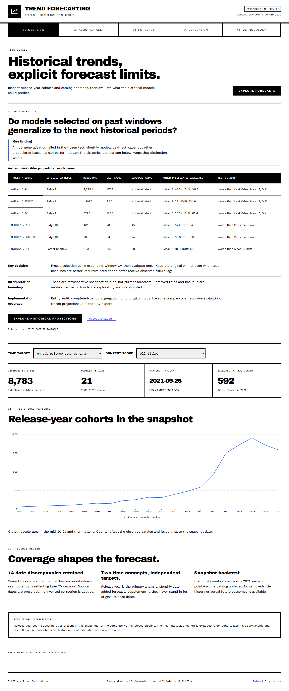
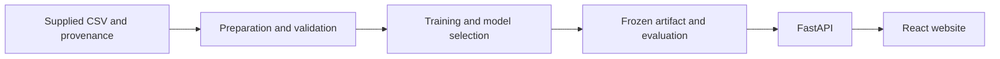

# Netflix Trend Forecasting

Do historical validation winners generalize to later catalog periods? This project studies annual release cohorts and monthly additions with chronological model selection, simple baselines and explicit failure reporting. Intended for retrospective analysis, not current forecasts.

[Open live application](https://netflix-trend-forecasting.shafwan.digital)



## Measured results

<!-- RESULTS:START -->
Evidence run: `20261106T122211417836Z`. Generated from the active artifact; not a business-impact claim.

Annual generalization failed; monthly results depend on the baseline. Model selection remains frozen.

| Target / scope | CV-selected model | Test MAE | Last value MAE | Seasonal naive MAE |
| --- | --- | ---: | ---: | ---: |
| releases / all | ridge_1 | 2395.37 | 137.75 | Not evaluated |
| releases / movies | ridge_1 | 1801.70 | 95.50 | Not evaluated |
| releases / tv | ridge_1 | 527.58 | 125.75 | Not evaluated |
| additions / all | ridge_100 | 48.11 | 70.00 | 45.33 |
| additions / movies | ridge_100 | 28.51 | 54.00 | 24.50 |
| additions / tv | forest_shallow | 19.33 | 20.33 | 20.83 |

MAE is titles per period. Other predeclared candidates remain in Evaluation. This single snapshot is not point-in-time history; projections are historical as-of estimates and error bands are not calibrated confidence intervals.
<!-- RESULTS:END -->

## Decisions and implementation

Use expanding-window CV and recursive held-out evaluation. Keep failed annual results and stronger baseline results visible instead of selecting again from test scores.

The implementation covers data audit and preparation, model comparison, saved evaluation artifacts, a FastAPI service, a React workspace, validation and Docker packaging. This describes repository capabilities; no business adoption or measured commercial impact is claimed.



## Reproduction boundary

**Artifact inference:** the included validated bundle supports the website without the raw CSV. **Training reproduction:** requires the original supplied CSV matching [the provenance record](data/provenance.json). The exact upstream source and redistribution permission remain unverified; no public substitute is asserted to reproduce this training input. The observed maximum date added is not a known acquisition date.

## Quickstart

Install Node 24, Python 3.11, Git and uv. In this repository's root:

```powershell
corepack enable
corepack pnpm install --frozen-lockfile
uv sync --frozen --all-packages
corepack pnpm dev
```

Open http://127.0.0.1:5173. API docs: http://127.0.0.1:8000/docs. Stop both services with Ctrl+C. Run one repository at a time with these default ports.
The included validated bundle supports inference without the raw CSV. Training needs your own supplied `data/raw/Dataset.csv`, excluded from Git.

## Reproduce and verify

```powershell
uv run python scripts/train_forecasting.py
uv run python scripts/refresh_dataset.py
corepack pnpm types
uv run ruff check .
corepack pnpm test
corepack pnpm build
uv run pytest
corepack pnpm verify
```

Training creates a new immutable run; regenerate the dataset profile whenever activating another run. The API refuses a stale profile. No performance values are invented by the frontend. Run `uv run python scripts/refresh_readme.py` to update only the marked results above, or append `--check` to verify them. Source/provenance and run mismatches fail the command.

## Structure and documentation

- `apps/web`: project frontend; `/overview`, `/dataset`, project action, `/evaluation`, `/methodology`.
- `apps/api`: HTTP validation, artifact serving and `/api/v1/dataset`.
- `packages/ml`: shared utilities and project ML implementation; serialized class paths retained for artifact compatibility.
- `artifacts/task-05`: one selected run, checksums and active pointer.
- `reports/dataset-profile.json`: run-bound source, variables, decisions and intermediate outcomes.
- [Project verification](docs/VERIFICATION.md)
- [Docker / VPS deployment](docs/DEPLOYMENT.md)
- [Architecture and deployment](docs/ARCHITECTURE.md)
- [Experiment evidence and provenance](docs/project/)

Independent project; not affiliated with Netflix. This is a historical 2021 catalog snapshot, not a current data service. Models describe metadata associations, not causation. Raw-data redistribution rights are not assumed.

Data visualization: [semantic colors and accessibility](docs/architecture/data-visualization.md).

Mobile layout: [responsive behavior and test replay](docs/architecture/mobile.md).

- [Project identity and logo assets](docs/architecture/branding.md)

- [Documentation index](docs/README.md)
- [Local development](docs/DEVELOPMENT.md)
