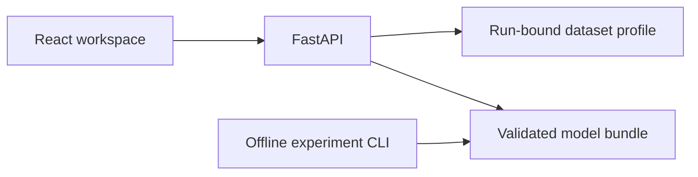

# Application architecture

`apps/web` owns navigation, forms and charts. `apps/api` validates HTTP requests and serves the built frontend and saved results under one origin. `packages/ml` owns preparation, offline experiments and inference. The API and command-line tools import the same implementation.

## HTTP contract

Health is exposed at `/api/v1/health`; dataset documentation is served at `/api/v1/dataset`. The established model endpoint prefix is `/api/v1/tasks/5`. The registry `/api/v1/tasks` contains the current project. These are literal API paths; generated TypeScript types come from [OpenAPI](architecture/openapi.json).

The frontend routes are `/overview`, `/dataset`, `/forecast`, `/evaluation` and `/methodology`. Unknown pages show a not-found view; unknown API paths return HTTP 404. Invalid model inputs return HTTP 422; unavailable artifacts return HTTP 503.

## Artifact lifecycle

Offline commands create a new immutable run under `artifacts/task-05/`. An active pointer selects a checksummed bundle. Startup validates identity, dependencies and integrity before loading trusted joblib files. The dataset profile must match the active model run. HTTP requests never train models or modify reports.

Serialized Python module paths and storage keys remain stable so existing saved models can be loaded. Figures, notebooks and reports record the run used for their results; changing documentation does not create a new experiment.

## Operation

See [development](DEVELOPMENT.md) for setup and troubleshooting, [deployment](DEPLOYMENT.md) for Docker/HTTPS and rollback, and [verification](VERIFICATION.md) for recorded checks. No database, authentication service, public upload or runtime training service is required.

## Portfolio presentation data flow

Overview reads the existing frozen evaluation endpoint and the run-bound dataset endpoint; mismatched runs or unavailable evidence block the summary and expose retry. No headline metrics are separately entered in frontend code. Source provenance is an additive typed field on `GET /api/v1/dataset`; its hash must match the loaded model metadata. OpenAPI remains the source of TypeScript API types.

The build emits five HTML shells with route-specific title, description, canonical, Open Graph and Twitter metadata. These are metadata documents for the existing SPA, not server-rendered analysis pages. FastAPI serves a route shell when available, regular files for assets, and the existing SPA fallback otherwise. Runtime inference and evaluation APIs do not train or rewrite artifacts.

READMEs obtain their marked result sections from active, checksum-validated artifact files through `scripts/refresh_readme.py`. Model artifact bytes remain immutable. The repository remains independent of the other catalog projects.
