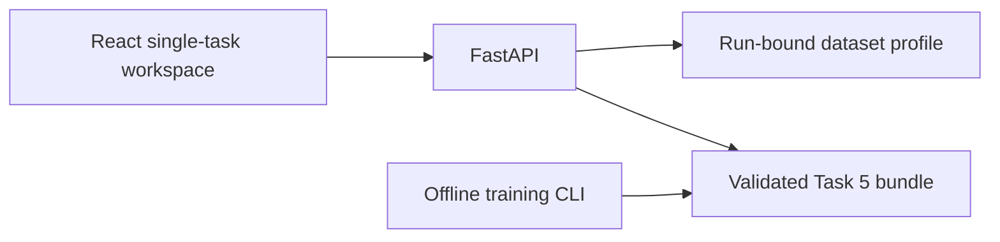

# Architecture and operation

The API imports only Task 5. `/api/v1/tasks` contains one entry; other task APIs return 404. Browser links are real URLs without task switching. API versioned task paths remain stable for compatibility; generated TypeScript schemas come from this repository's OpenAPI document.

The ML package retains task-specific module paths required by joblib. Shared source validation is independent of other tasks. Fitting never runs in an HTTP request. Only trusted local bundles are loaded; no upload endpoint is provided. Checksums validate each immutable run and the dataset profile must match the active run ID.

## Deployment preparation

Run `corepack pnpm build` then `uv run python -m uvicorn netflix_api.main:app --host 0.0.0.0 --port 8000`. The API serves the built SPA and `/api` under one origin. Root and direct section URLs work through the SPA fallback; unknown API paths remain 404.

Alternatively `docker build -t netflix-trend-forecasting .` and `docker run --rm -p 8000:8000 netflix-trend-forecasting`. The container includes only the selected task bundle and reports, with a non-root runtime user. Container definition is provided; a successful Docker build is not implied unless recorded in verification results.

## Troubleshooting

- Artifact unavailable: inspect active pointer, bundle checksums and startup logs; do not retrain through the API.
- Dataset unavailable after training: run `uv run python scripts/refresh_dataset.py` and restart the API.
- Port occupied: stop the other task's development server before `pnpm dev`.
- Raw data missing: put the original supplied CSV at `data/raw/Dataset.csv`; verify the source hash in About Dataset.
- No `pnpm` command: use `corepack pnpm` or install the pinned pnpm version with npm.

## Evidence provenance

Copied task reports/notebooks preserve the original experiments and run identities. Historical references to the former combined application describe that original delivery, not new screenshots. New browser evidence belongs in `output/playwright` and must be identified as the standalone baseline or subsequent redesign. No old screenshot is relabeled as new evidence.
